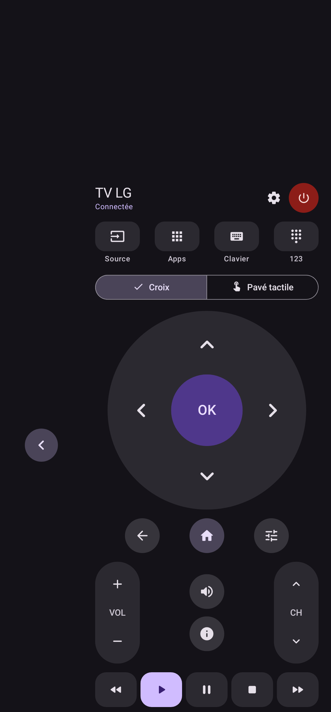
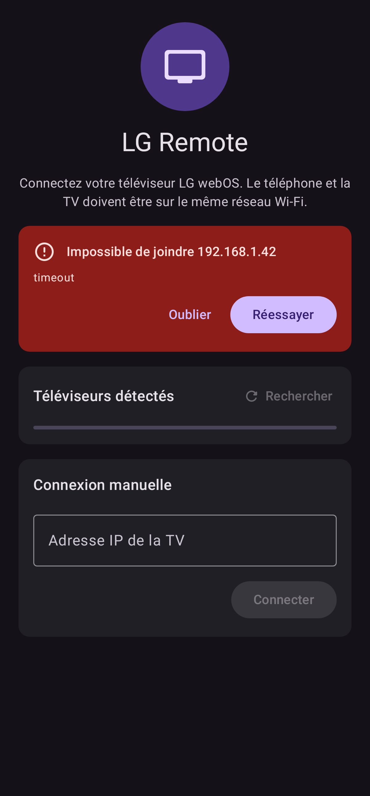
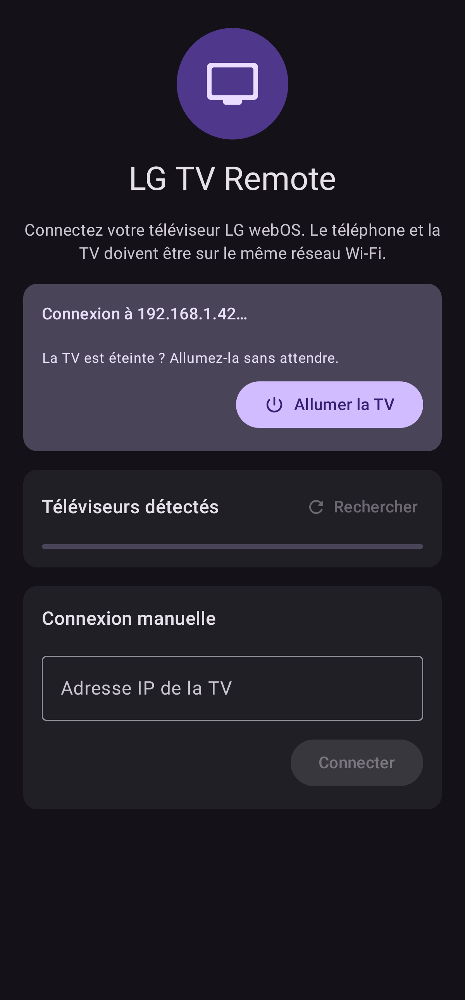
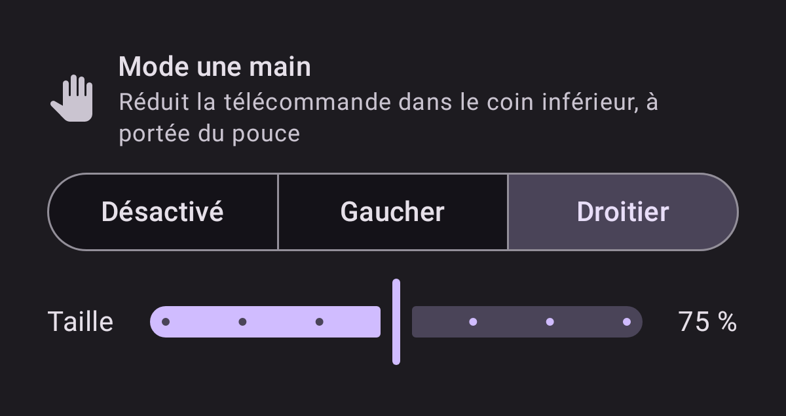
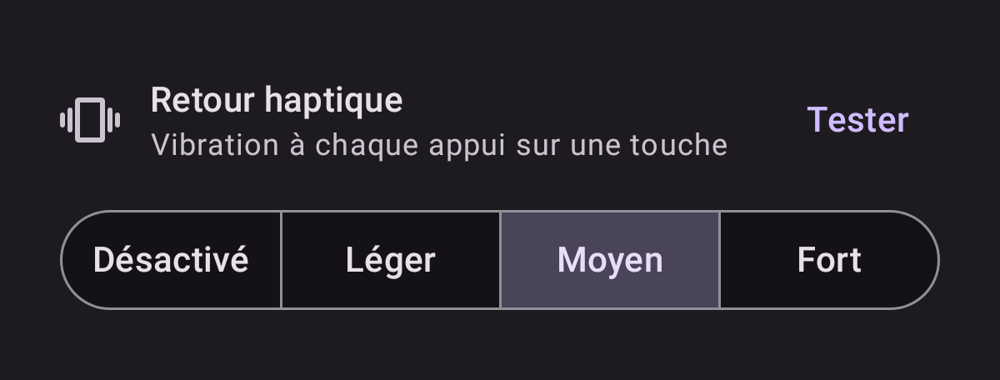

# LG Remote

Android remote control for LG webOS TVs over Wi-Fi. Kotlin, Jetpack Compose, Material 3 with Material You dynamic colors.

<table>
  <tr>
    <td align="center"><br><sub>Dark</sub></td>
    <td align="center"><br><sub>Light</sub></td>
    <td align="center"><br><sub>One-handed</sub></td>
    <td align="center"><br><sub>Connect</sub></td>
    <td align="center"><br><sub>Power on</sub></td>
  </tr>
</table>

## Install

Download [`apk/LG-Remote-1.0.apk`](apk/LG-Remote-1.0.apk) (or the latest [release](../../releases)) and allow installs from unknown sources. Android 8.0 or newer is required.

Your phone and TV must be on the same network. To turn the TV on remotely, enable *Settings → General → Devices → Turn on via Wi-Fi* (or *Mobile TV On*) on the TV.

## Features

- Finds TVs automatically (SSDP), or connect by IP address
- Pairs once, then reconnects automatically
- D-pad, OK, Back, Home and Settings, with auto-repeat on long press
- Touchpad for the Magic Remote pointer, plus a scroll strip
- Volume, channels and mute; the phone's volume keys control the TV
- Media controls, app launcher with icons, input switcher, keyboard, number pad and color keys
- Power off, and power on with Wake-on-LAN (also offered while connecting)
- One-handed mode for left or right hand, with an adjustable size (60–90 %)
- Adjustable haptic feedback

<p align="center">
<br>

</p>

## Build

```bash
./gradlew assembleRelease                                  # app/build/outputs/apk/release/app-release.apk
./gradlew testDebugUnitTest -Proborazzi.test.record=true   # regenerate the screenshots in docs/
```

Pushing a `v*` tag, or running the workflow manually with a tag, publishes a GitHub release with the APK.

### Signing

Release builds are signed with a fixed key so each version installs over the previous one. The key is not in the repository.

- **Local:** put `release.jks` and `keystore.properties` in `signing/` (git-ignored):
  ```properties
  storeFile=signing/release.jks
  storePassword=…
  keyAlias=lgremote
  keyPassword=…
  ```
- **GitHub Actions:** secrets `SIGNING_KEYSTORE_BASE64`, `SIGNING_STORE_PASSWORD`, `SIGNING_KEY_ALIAS`, `SIGNING_KEY_PASSWORD`.

Without a key, the build falls back to the debug key, and the APK cannot update a release-signed install.

Certificate SHA-256: `eb4b919d3679167e29ac330bce536c7d3f2796e1bac17af4c584f21e9e06a05b`

## How it works

LG SSAP protocol over WebSocket (`wss://<tv>:3001`, falling back to `ws://<tv>:3000`). Buttons go through the pointer input socket. See [`WebOsClient.kt`](app/src/main/java/com/moulinier/lgremote/tv/WebOsClient.kt).
