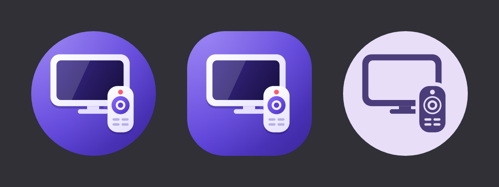
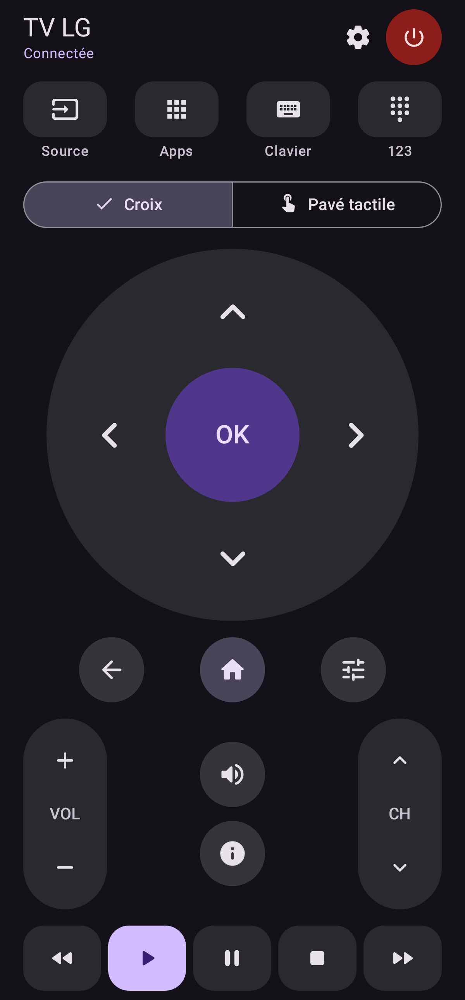
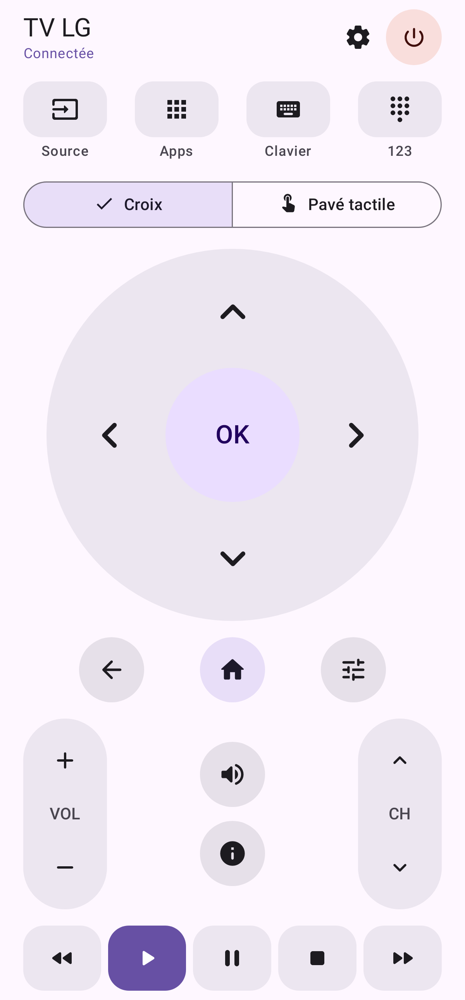

# LG Remote — télécommande Android pour TV LG webOS

Application Android moderne (Kotlin + Jetpack Compose, **Material Design 3** avec couleurs dynamiques Material You, thème clair/sombre) pour piloter une TV LG webOS via le Wi-Fi.

<p>


  
</p>

## Installation

Téléchargez **[`apk/LG-Remote-1.0.apk`](apk/LG-Remote-1.0.apk)** sur le téléphone, ouvrez-le et autorisez l'installation d'applications de sources inconnues. Android 8.0 ou plus récent est requis.

## Fonctionnalités

- **Détection automatique** des TV sur le réseau (SSDP), ou saisie manuelle de l'adresse IP
- **Appairage** sécurisé : la TV demande l'autorisation la première fois, puis la clé est mémorisée et la reconnexion est automatique
- **Croix directionnelle + OK**, Retour, Accueil, Réglages, avec appui long qui répète la commande
- **Pavé tactile** pour piloter le pointeur (Magic Remote) et une bande de défilement
- **Volume / Chaînes** (bascules), Muet, Infos, et les **touches volume du téléphone** qui contrôlent la TV
- **Lecture multimédia** : lecture, pause, stop, retour et avance rapides
- **Applications** : grille des applis installées avec leurs icônes, lancement en un tap
- **Sources** : changement d'entrée HDMI / TV
- **Clavier** : saisie de texte directement dans les champs de la TV
- **Pavé numérique** + touches de couleur, menu rapide, liste des chaînes
- **Extinction**, et **allumage par Wake-on-LAN** (adresse MAC détectée automatiquement, modifiable dans les réglages)
- Retour haptique sur chaque touche, réglable dans les Réglages (désactivé, léger, moyen, fort)

## Prérequis côté TV

- Téléphone et TV sur le même réseau
- Pour l'allumage à distance, activez sur la TV : *Paramètres → Général → Appareils → Allumer via Wi-Fi* (ou *Mobile TV On*). L'intitulé varie selon la version de webOS.

## Compilation

```bash
./gradlew assembleRelease          # → app/build/outputs/apk/release/app-release.apk
./gradlew testDebugUnitTest -Proborazzi.test.record=true   # régénère les captures dans docs/
```

### Signature

L'APK de release est signé avec une clé fixe, pour que chaque nouvelle version s'installe par-dessus la précédente. La clé n'est **pas** dans le dépôt :

- **En local** : placez `release.jks` et `keystore.properties` dans un dossier `signing/` à la racine (ignoré par git). Format de `keystore.properties` :
  ```properties
  storeFile=signing/release.jks
  storePassword=…
  keyAlias=lgremote
  keyPassword=…
  ```
- **Sur GitHub Actions** : secrets `SIGNING_KEYSTORE_BASE64` (le fichier `.jks` en base64), `SIGNING_STORE_PASSWORD`, `SIGNING_KEY_ALIAS` et `SIGNING_KEY_PASSWORD`.

Sans clé configurée, le build retombe sur la clé de debug de la machine : l'APK obtenu ne pourra pas mettre à jour une version signée avec la clé fixe.

Empreinte SHA-256 du certificat : `eb4b919d3679167e29ac330bce536c7d3f2796e1bac17af4c584f21e9e06a05b`

## Technique

Protocole LG SSAP sur WebSocket (`wss://<tv>:3001`, repli sur `ws://<tv>:3000`). Les boutons passent par le socket d'entrée du pointeur (`getPointerInputSocket`). Code principal : `app/src/main/java/com/moulinier/lgremote/tv/WebOsClient.kt`.
